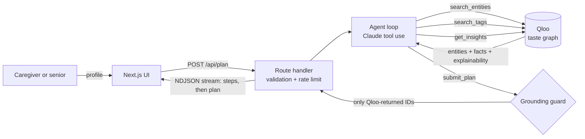

<div align="center">

# 🌿 Evergreen

### Care that knows what they love.

An AI agent that plans a gentle week of **meals, music, shows and outings** for older adults, built around the things they genuinely love and adapted to how they eat and move today. Every pick is grounded in **Qloo's taste graph**.

[](https://qloo.devpost.com/)
[](https://nextjs.org/)
[](https://www.anthropic.com/)
[](LICENSE)

**[Live demo](#live-demo)** · **[How Qloo powers it](#how-qloo-powers-it)** · **[Run it locally](#run-it-locally)**

</div>

---

## The problem

Caring for an older parent, grandparent or client usually means two separate lists:

- **What they love**: Patsy Cline, *Casablanca*, Sunday-night Italian.
- **What they need now**: soft food, low sodium, quiet rooms, step-free entrances.

Generic assistants give "soft Italian food and some oldies" and call it personalised. Care apps handle the needs and ignore the person. The result is a plan that is *technically fine* and emotionally flat.

## What Evergreen does

You tell it a few favourites, a birth year, a city and everyday needs. A Claude-powered agent then works through Qloo's taste graph and returns:

| | |
|---|---|
| 📅 **A week, not a list** | A Monday-to-Sunday rhythm with morning, lunch, afternoon and evening slots. Rest days included, never two outings in one day. |
| 🍽 **Dining that fits** | Real restaurants near them, matched to their tastes, with a care note per pick (texture, salt, noise, when to go). |
| 🎵 **Music and screen time from their era** | Artists and shows that sit close to their favourites in the taste graph, with film and TV limited to their formative years. |
| ♿ **Accessibility, from data** | Wheelchair-accessible entrances, seating, restrooms and parking shown as chips *when Qloo lists them*. |
| 🧭 **Visible reasoning** | Each card says which of their favourites drove the match, and a live trace shows every Qloo call the agent makes. |
| 👍 **"Not for them"** | Reject a pick and refresh. Rejected entities are passed back to Qloo as exclusions, and the agent is told to avoid close alternatives. |

Plus conversation starters for caregivers, a larger-text mode, a print layout, copy-as-text, and a remembered profile.

## How Qloo powers it

The brief was: *"If your submission would work the same without Qloo, you're building the wrong thing."* Evergreen is designed so that removing Qloo removes the product.

**Cross-domain taste inference.** A love of Patsy Cline and *Casablanca* is passed to the Insights API as `signal.interests.entities`, and it steers which **restaurants**, **TV shows** and **outings** fit. That is something an LLM alone cannot know.

**Era-aware nostalgia.** For film and TV the agent sets `filter.release_year.min/max` to the person's formative decades, so recommendations feel remembered rather than discovered.

**Needs become filters.** Everyday needs are translated into Qloo tags (`/v2/tags`) and used with `filter.tags` and `filter.exclude.tags`.

**Explainability.** `feature.explainability=true` tells us which input favourites contributed to each result. The UI shows it as *"Qloo matched this to: …"*.

**Honest accessibility.** Qloo returns 100+ tags per place. Evergreen keeps the meaningful ones (category, cuisine, ambience, accessibility) and hands the agent a compact `facts` list. The agent is instructed to claim accessibility or atmosphere **only if it appears in those facts**, and otherwise say "worth calling ahead to confirm".

| Endpoint | Used for |
|---|---|
| `GET /search` | Resolve favourites ("Patsy Cline") to Qloo entity IDs |
| `GET /v2/tags` | Find valid tag IDs for cuisines, moods, venue types |
| `GET /v2/insights` | Recommendations for `place`, `artist`, `movie`, `tv_show` (and book, podcast, brand, destination) with entity and tag signals, tag filters and exclusions, location, release-year window, entity exclusions and explainability |

## Architecture



**The grounding guard** is the key design decision. The model can only submit entity IDs that came back from a `get_insights` call in the same run. Anything it invents is dropped server-side before the plan reaches the UI. Every card you see is a real Qloo entity.

**Streaming.** A run makes 14-17 Qloo calls and takes about a minute, so the API streams newline-delimited JSON. The UI shows each step as it happens instead of a spinner.

## Design for the audience

Built for older readers and tired caregivers:

- 20px base text with nothing smaller than 16px, and a one-tap **Larger text** mode
- High-contrast palette, big tap targets, visible keyboard focus
- Plain-spoken notes, no jargon
- Print layout for the fridge door
- Not medical advice, and it says so (see [Responsible use](#responsible-use))

## Run it locally

You need Node 20+, a [Qloo hackathon API key](https://docs.qloo.com/reference/qloo-llm-hackathon-developer-guide) and an Anthropic API key.

```bash
git clone https://github.com/divergent99/Evergreen.git
cd Evergreen
npm install
cp .env.example .env.local     # then add your keys
npm run dev                    # http://localhost:3000
```

| Variable | Purpose |
|---|---|
| `QLOO_API_KEY` | Qloo hackathon key (sent as `X-Api-Key`) |
| `QLOO_BASE_URL` | `https://hackathon.api.qloo.com`. Hackathon keys only work here |
| `ANTHROPIC_API_KEY` | Drives the agent loop |
| `ANTHROPIC_MODEL` | Optional model override |
| `RATE_LIMIT_PER_HOUR` | Optional per-IP limit (default 12) |
| `DEMO_MODE` | `1` returns a hard-coded sample plan for UI work. **Never set in production** |

Check your Qloo key and the response shapes before running the app:

```bash
node --env-file=.env.local scripts/qloo-smoke.mjs
```

## Deploy

Works on any Node host without a short request timeout. On **Railway**:

1. New Project, **Deploy from GitHub repo**, pick this repo.
2. Add `QLOO_API_KEY`, `QLOO_BASE_URL` and `ANTHROPIC_API_KEY` as variables.
3. Settings, Networking, **Generate Domain**.

## Live demo

> 🔗 Add the deployed URL here after the Railway deploy.

Click **Fill in an example** to load a sample profile, then **Plan their week**.

## Project structure

```
app/
  page.tsx            UI: form, live progress, week view, cards, reject/refresh
  api/plan/route.ts   Validation, rate limit, NDJSON streaming
lib/
  agent.ts            Claude tool-use loop, system prompt, grounding guard
  qloo.ts             Qloo client + tag digestion (display tags, access, facts)
  demo.ts             Sample plan for DEMO_MODE (contains no Qloo data)
scripts/
  qloo-smoke.mjs      Prints real Qloo response shapes for a quick check
```

## Responsible use

- **Not medical advice.** Evergreen suggests tastes and comforts. Needs like low sodium or soft food are handled as preferences with practical tips, and the agent is instructed never to give medical or medication advice. Always confirm with a doctor or dietitian.
- **Accessibility is "per Qloo".** It reflects Qloo's data, and the app encourages calling ahead.
- **Privacy.** There is no database and no account. The profile lives in your browser's local storage, and profile text is sent to the Anthropic API to generate the plan.
- **Qloo data** is not stored or committed to this repository, per the hackathon terms.

## Roadmap

- Taste profile summary ("warm, nostalgic, unhurried") at the top of each plan
- Shareable plan links for families
- Care-home mode: plan for a group with overlapping tastes
- Calendar export for the weekly schedule

## License

[MIT](LICENSE). Built for the [Qloo Agentic Hackathon](https://qloo.devpost.com/).
